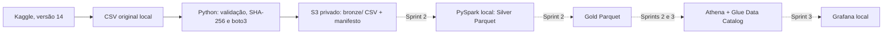

# Documentação técnica — Sprint 1

## Arquitetura autorizada



Um bucket armazena os prefixos `bronze/`, `silver/`, `gold/` e `athena-results/`. Prefixos S3 são lógicos: só aparecem após a gravação de objetos. A Bronze recebe o arquivo sem alteração, com chave baseada em SHA-256. O manifesto fica ao lado do CSV e registra origem, licença, versão, esquema, hash, tamanho, linhas, horário UTC e identificador da execução.

## Convenções de objeto

```text
s3://<bucket>/bronze/dataset=multilingual-customer-support-tickets/version=14/sha256=<sha256>/dataset-tickets-multi-lang3-4k.csv
s3://<bucket>/bronze/dataset=multilingual-customer-support-tickets/version=14/sha256=<sha256>/manifest.json
```

`IfNoneMatch=*` impede sobrescrita nas duas gravações; a rotina confirma tamanho, metadado SHA-256, checksum quando o S3 o retorna, e vínculo do manifesto ao CSV. O checksum SHA-256 é enviado ao S3 no upload. Uma reexecução reutiliza os objetos existentes. Se CSV existir e manifesto faltar, a rotina conclui o manifesto.

## Segurança e IAM

- Autenticação por perfil AWS CLI/SSO ou credenciais temporárias. Não usar root nem guardar chaves no repositório.
- O script `scripts/provision_aws.sh` cria orçamento primeiro; depois bucket com bloqueio de acesso público, propriedade `BucketOwnerEnforced`, SSE-S3, versionamento e política que exige TLS.
- Para a conta pessoal, [docs/aws_access.md](docs/aws_access.md) contém um roteiro sequencial para quem começa no IAM: conta root, preparo dos JSON, cliques no console, MFA, perfil local, provisionamento e ingestão. A política runtime cobre S3/Athena/Glue; a política temporária de bootstrap cobre Budgets e configuração do bucket. `scripts/create_ingest_policy.sh` permanece opcional para uma identidade separada de ingestão apenas em `bronze/`.
- O orçamento emite alertas, mas não interrompe cobranças automaticamente. O orçamento existente foi verificado em US$ 5/mês, com alertas em 80% e 100% para o e-mail fornecido pelo usuário. A AWS informou gasto calculado de US$ 0,00 no momento da consulta; esse valor pode mudar após a contabilização.

## Operação e validação

Ver [README.md](README.md) para comandos completos. O perfil `medallion-poc` foi autenticado como `user/medallion-poc-operator`. O bucket da POC foi criado em `us-east-1`; o AWS CLI confirmou bloqueio público total, SSE-S3, versionamento, tags e política que nega transporte sem TLS. O comando que define `BucketOwnerEnforced` terminou com êxito; uma consulta adicional de leitura recebeu `AccessDenied` porque a política IAM não concede `s3:GetBucketOwnershipControls`.

O CSV original e o manifesto foram enviados à Bronze. `head-object` confirmou CSV com 6.873.542 bytes, metadado SHA-256 e checksum SHA-256 em base64; os dois objetos usam SSE-S3. Uma cópia baixada do CSV foi idêntica em bytes ao original, e o manifesto declarou 4.000 linhas, 17 campos, versão 14 e licença CC BY 4.0. A reexecução retornou os mesmos IDs de versão dos dois objetos. O orçamento informou US$ 0,00 de gasto calculado no momento da consulta, sujeito a atraso de contabilização. O fechamento administrativo ainda requer remover `MedallionPocBootstrap` e confirmar o MFA no console; o usuário da POC não possui permissão IAM para fazer essa remoção pelo CLI.

## Limitações

O perfil do dataset consta em [docs/dataset.md](docs/dataset.md). O CSV de 4.000 linhas não contém ID ou data de negócio; a interpretação como tickets ITSM é aproximada. A rotina de upload usa `put_object` de uma só parte e foi dimensionada para o arquivo escolhido de 6,9 MB. Alteração de fonte/arquivo exige nova validação e atualização do hash fixado.
