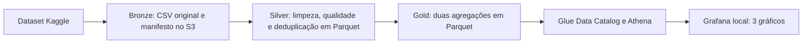

# Data Lake Medalhão na AWS para tickets de suporte

Prova de conceito acadêmica de um data lake para análise de tickets de suporte. O projeto usa um conjunto de dados público do Kaggle, processa os registros com PySpark e disponibiliza tabelas em Parquet para consulta no Amazon Athena. As camadas Bronze, Silver e Gold e o catálogo Athena estão implementados. A Sprint 3 adiciona um painel Grafana local com três gráficos e uma rotina de validação de ponta a ponta.

## Fonte de dados

O dataset é [Customer IT Support - Ticket Dataset](https://www.kaggle.com/datasets/tobiasbueck/multilingual-customer-support-tickets), de Tobias Bueck, sob licença [CC BY 4.0](https://creativecommons.org/licenses/by/4.0/). A POC usa o arquivo `dataset-tickets-multi-lang3-4k.csv` da versão 14, com 4.000 registros e 17 campos. Ele inclui assunto, descrição, resposta, tipo, fila, prioridade, idioma e tags.

O CSV original contém texto livre e não é versionado neste repositório. O esquema, o perfil dos dados e as limitações do recorte estão em [docs/dataset.md](docs/dataset.md).

## Arquitetura



- **Bronze:** preserva o CSV original e um manifesto com informações da fonte e verificação de integridade.
- **Silver:** padroniza os campos, cria um identificador derivado, remove duplicatas e registra métricas de qualidade.
- **Gold:** oferece contagens por tipo e prioridade e por fila e idioma, considerando apenas registros válidos.
- **Consulta:** três tabelas externas no catálogo permitem explorar Silver e Gold com SQL no Athena.
- **Visualização:** três gráficos do Grafana consultam as tabelas Gold pelo plugin oficial Athena.

## Requisitos

- Python 3.11 ou superior e Java 17 ou superior para execução local com PySpark.
- Dependências Python de [requirements.txt](requirements.txt).
- AWS CLI v2 e um perfil com acesso aos serviços S3, Athena e Glue para reproduzir as etapas na AWS.
- Docker Desktop para iniciar o Grafana local da Sprint 3.
- Acesso ao Kaggle para baixar a versão do dataset usada na POC.

Para preparar o ambiente local:

```bash
python3 -m venv .venv
.venv/bin/python -m pip install -r requirements.txt
SPARK_LOCAL_IP=127.0.0.1 .venv/bin/python scripts/check_spark.py
```

Os diretórios `data/`, `.venv/` e `.tools/` ficam fora do Git. Os testes podem ser executados com:

```bash
SPARK_LOCAL_IP=127.0.0.1 .venv/bin/python -m unittest discover -s tests -v
```

## Sprint 3: painel e validação

Com o perfil `medallion-poc` autenticado como usuário IAM e o Docker Desktop ativo:

```bash
bash scripts/run_grafana.sh
python3 src/validate_grafana.py
bash scripts/run_sprint3.sh
.venv/bin/python src/collect_grafana_query_stats.py --profile medallion-poc --region us-east-1
```

Painel local: <http://localhost:3000/d/medallion-it-tickets>. A senha local está em `data/staging/grafana-admin-password.txt`. As evidências de execução ficam em `data/processed/`, fora do Git. O custo faturado atual ainda requer acesso ao orçamento; os bytes lidos pelo Athena não são uma medição da cobrança.

## Documentação

- [Plan.md](Plan.md): etapas e estado do projeto.
- [Documentation.md](Documentation.md): arquitetura e decisões técnicas.
- [docs/sprint2.md](docs/sprint2.md): regras de transformação, artefatos, execução e validação.
- [docs/sprint3.md](docs/sprint3.md): Grafana, execução de ponta a ponta, evidências e passo a passo de custo.
- [docs/sprint3_evidencias.md](docs/sprint3_evidencias.md): resultados medidos e IDs de rastreabilidade.
- [docs/relatorio_final.md](docs/relatorio_final.md): síntese técnica e estado da entrega.
- [docs/aws_access.md](docs/aws_access.md): configuração de acesso à AWS.
- [docs/diario_do_projeto.md](docs/diario_do_projeto.md): histórico das implementações e evidências.
