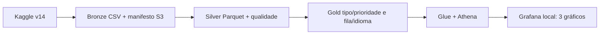

# Relatório final — POC Data Lake Medalhão

## Objetivo e arquitetura

Esta POC organiza o dataset público multilíngue de tickets de suporte em Bronze, Silver e Gold no S3. O PySpark local limpa, padroniza, deduplica e agrega; o Glue Data Catalog descreve as tabelas Parquet/Snappy; o Athena responde às consultas; o Grafana local apresenta três distribuições. O dataset selecionado contém 4.000 registros e 17 campos. Ele não inclui ID ou data de negócio, portanto não permite inferir SLA, tendências temporais ou idade dos tickets.

## Resultado verificado

| Critério | Evidência anterior | Estado da Sprint 3 em 2026-11-22 |
| --- | --- | --- |
| Bronze íntegra | SHA-256 fixado `9aae7120cf459fc27561febe29c7757c6d222bfebff50e8baa868991e57b87d1`; manifesto e S3 verificados na Sprint 1 | CSV, manifesto, checksum, metadados e versões S3 reconferidos. |
| Reconciliação | Sprint 2: 4.000 fonte, 4.000 Silver, 0 duplicatas, 4.000 válidos, 0 rejeitados; duas Gold somam 4.000 | Reexecução local em 10,6 s e AWS em 19,37 s; mesmos totais e zero divergências por grupo. |
| Athena | Sprint 2: seis consultas aprovadas, 7.478 bytes lidos | Nova execução: seis checks aprovados, 7.478 bytes; IDs e duração por consulta registrados. |
| Grafana | Configuração e três consultas provisionadas | Fonte `OK`; três gráficos consultados com dados reais: 4 tipos, 10 filas, 5 idiomas, 4.000 tickets em cada. |
| Custo observado | Última leitura anterior do orçamento: US$ 0,00 após a ingestão da Sprint 1; dado sujeito a atraso | Leitura atual indisponível (`AccessDeniedException` e sem acesso ao orçamento no Console). Bytes Athena não são valor faturado. |

O resultado técnico da Sprint 3 foi validado. A reexecução e a validação do painel geraram `data/processed/sprint3_evidence.json`, `sprint3_grafana_validation.json` e `sprint3_grafana_athena_stats.json`. As seis consultas do painel feitas em duas rodadas leram 2.352 bytes. Somadas aos 7.478 bytes das consultas de validação do pipeline, as consultas registradas leram 9.830 bytes. Não é possível converter esse volume diretamente em custo faturado. A leitura atual do orçamento continua pendente; as instruções para obtê-la estão em [sprint3.md](sprint3.md).

O registro versionado de contagens, versões S3, IDs e duração das consultas está em [sprint3_evidencias.md](sprint3_evidencias.md).

## Limitações e próximos cuidados

Os dados são um recorte acadêmico, não tickets de produção. O ID Silver é derivado do conteúdo, inclusive da resposta. A Gold contém apenas linhas válidas. O Grafana local usa credenciais AWS temporárias que precisam ser renovadas ao expirar; o painel não tem atualização automática para evitar consultas repetidas. O orçamento de US$ 5 é um alerta mensal, não um bloqueio de gastos. Os bytes lidos pelo Athena e o gasto mensal da conta têm escopos diferentes.

## Referências do projeto

- [Documentação técnica](../Documentation.md)
- [Sprint 2](sprint2.md)
- [Sprint 3 e roteiro de reprodução](sprint3.md)
- [Dataset e licença](dataset.md)
- [Diário de implementação](diario_do_projeto.md)
